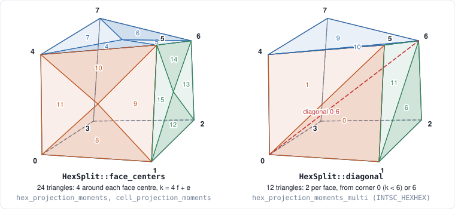
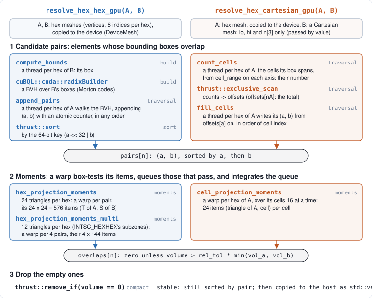
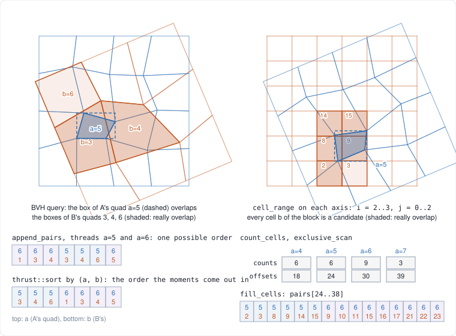
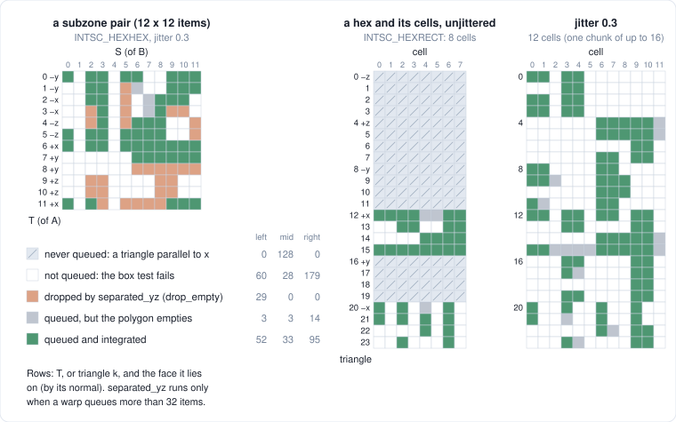
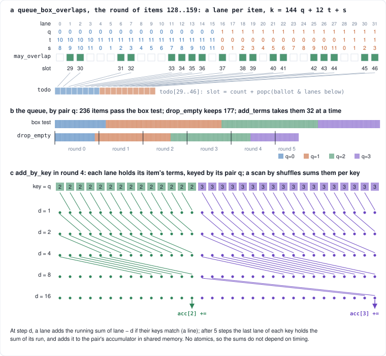
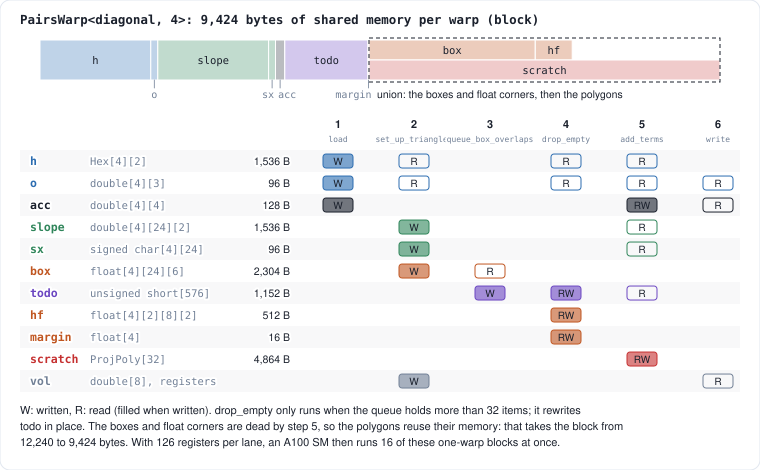
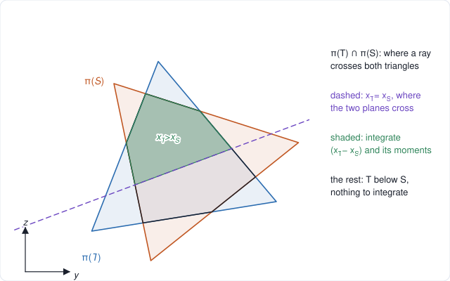
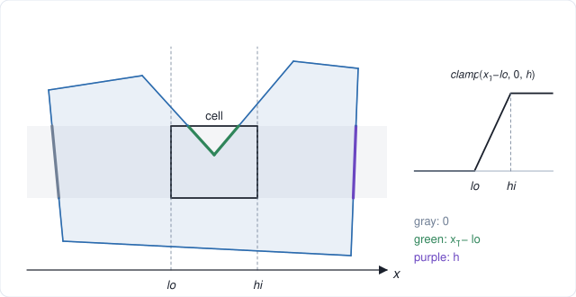

# How the queries run: hex-hex and hex-Cartesian overlaps

This note follows the data through the two queries, from two meshes to the list of their overlaps:
- `resolve_hex_hex_gpu`: a hex mesh against a hex mesh;
- `resolve_hex_cartesian_gpu`: a hex mesh against a Cartesian grid.

It covers what each stage computes, which thread computes it, and where the data lives in between.

[`projection_moments.md`](projection_moments.md) explains the mathematics. Here, the term of one
*item* is treated as a black box:
- an item is a boundary triangle T of a hex of A paired with a boundary triangle S of a hex of B (or with a cell of B);
- [`add_projected_pair`](../src/tet/projection.hpp) (or `add_projected_box`) adds that item's
  term to the moments of the overlap;
- the overlap of two elements is the sum of the terms of all their items.

The algorithm is mostly about finding the few items that matter, and keeping a GPU's lanes busy
with them.

**In this branch.** This report describes the code of the tet_intersection project, where the
method was developed. This branch adds a copy of two of its kernels to the suite, as the
`projection` tuning of the `Base_CUDA` variants of INTSC_HEXHEX and INTSC_HEXRECT:
- [`INTSC_HEXHEX-CudaProjection.cpp`](../src/apps/INTSC_HEXHEX-CudaProjection.cpp) is
  `hex_projection_moments_multi` (section 4.4).
- [`INTSC_HEXRECT-CudaProjection.cpp`](../src/apps/INTSC_HEXRECT-CudaProjection.cpp) is
  `cell_projection_moments` (section 4.5).
- [`src/tet/`](../src/tet/) holds unchanged copies of the method's headers, and of the kernels'
  warp helpers (`warp.cuh`).

The copies differ from the kernels described here in what the suite provides and expects:
- **The pairs are given.** The suite lists them, so stages 1 and 3 (finding the pairs, dropping the
  empty results) don't run.
  - INTSC_HEXHEX's pair `k` is donor `k` against target `k`.
  - For INTSC_HEXRECT, a small kernel (`donor_offsets`) finds each donor zone's first record before
    the moment kernel.
- **Every result is kept**, however small, as the suite keeps them. So there is no threshold, and
  no volumes of the elements for it (`vol` in figure 10).
- **The data comes in the suite's layouts:** node coordinate arrays, and corners numbered x fastest.
  The kernels map them to the corner numbering of figure 6.

`raja-perf.exe -k INTSC_HEXHEX INTSC_HEXRECT -v Base_CUDA` runs the suite's tunings and
`projection` side by side. At the default sizes, on an A100 at 1200 MHz (`block_64` -> `projection`):
- INTSC_HEXHEX: 2.78 -> 0.33 ms;
- INTSC_HEXRECT: 4.85 -> 1.83 ms.

Both pass the suite's checks.

Unless they are links, file names below are tet_intersection's.

**Contents**

1. [Inputs and outputs](#1-inputs-and-outputs)
2. [The three stages](#2-the-three-stages)
3. [Stage 1: candidate pairs](#3-stage-1-candidate-pairs)
4. [Stage 2: the moment kernels](#4-stage-2-the-moment-kernels)
5. [Stage 3: dropping the empty results](#5-stage-3-dropping-the-empty-results)
6. [The CPU versions](#6-the-cpu-versions)
7. [Where the time goes](#7-where-the-time-goes)
8. [Lessons from the optimization passes](#8-lessons-from-the-optimization-passes)

The figures are drawn by tet_intersection's `docs/projection/make_figures.py`
(`python3 make_figures.py`):
- **The geometry is computed, not sketched.** The queries in figure 7 are worked out on real
  meshes, and every item in figures 8 and 9 has the category the kernels' rules give it.
- **The rules match the library.** The script ports those rules from the C++. When the figures
  were made, all 1,056 items they show were checked against the library's own functions.
- **The example meshes** are set up as `raja_comparison` sets up its problems, with numpy's random
  numbers in place of the C++ generator.

---

## 1. Inputs and outputs

`include/tet/gpu_intersect.hpp` declares the queries; [`hex.hpp`](../src/tet/hex.hpp) defines the types:

```cpp
std::vector<Overlap> resolve_hex_hex_gpu(const HexMesh& A, const HexMesh& B, double rel_tol = 1e-10,
                                         GpuTimings* timings = nullptr, HexSplit split = HexSplit::face_centers);
std::vector<Overlap> resolve_hex_cartesian_gpu(const HexMesh& A, const CartesianMesh& B, double rel_tol = 1e-10,
                                               GpuTimings* timings = nullptr);
```

- **`HexMesh`:** vertex positions, plus 8 vertex indices per hex, with corners numbered as in
  figure 6 (as in VTK).
  - Faces need not be planar, and hexes need not be convex.
- **`CartesianMesh`:** only `lo`, `hi` and `n[3]`.
  - Cell `(i, j, k)` has index `i + n[0] (j + n[1] k)`; nothing per cell is stored.
- **The result** is one `Overlap {Pair {a, b}, Moments {volume, first}}` for each pair of elements
  whose overlap volume is above `rel_tol` times the smaller of the two elements' volumes.
  - `first` is $\int \mathbf x \, dV$ over the overlap, so the centroid is `first / volume`.
  - The overlaps are sorted by `(a, b)`.
- **`include/tet/hex_region.hpp`** has the CPU versions, with the same
  arguments and the same results (section 6).

### A hex's boundary triangles



A hex's geometry is that of its boundary triangles. There are two ways of splitting its faces,
`HexSplit`, and both are rebuilt from the 8 corners whenever needed (`Hex::triangle`):
- **`face_centers`** (the default): each face is split into 4 triangles around its centre (the
  average of its corners), 24 in all.
  - Triangle `k = 4 f + e` joins face `f`'s centre to its edge `e`.
  - Coned to the hex's centre, the triangles are the hex's 24 tets.
- **`diagonal`**: each face is split into 2 triangles along its diagonal through corner 0 or 6, 12
  in all.
  - Triangles 0–5 meet at corner 0, and triangles 6–11 at corner 6.
  - They bound the 6 tets around the diagonal from corner 0 to 6, which are the *subzones* of
    RAJAPerf's INTSC_HEXHEX. `raja_comparison --hexhex` uses this split.

The two splits are the same solid when the faces are planar. Either way, a hex's volume (for the
`rel_tol` threshold) is the sum of its triangles' cones to its centre, so it is computed from the
same triangles as the overlaps.

## 2. The three stages



Both queries run the same three stages. Each kernel's time goes into one of the `GpuTimings`
fields (in grey in figure 5), which `mesh_compare` and `raja_comparison` print.

1. **Candidate pairs:** every pair `(a, b)` whose bounding boxes overlap, sorted by `(a, b)`.
   Hex-hex queries find them with a BVH; hex-Cartesian queries need none.
2. **Moments:** a moment kernel writes one `Overlap` per candidate pair, in the same order. The
   result is zero when the overlap is not above the threshold: the boxes overlap, but the elements
   don't, or only barely.
3. **Dropping the empty ones:** a stable compaction removes the zeros, and the rest are copied to
   the host.

Everything stays on the device between stages. Only the number of candidate pairs goes back to the
host in between, to size the buffers that follow.

## 3. Stage 1: candidate pairs



Figure 7 shows both in 2D, with quads for hexes and squares for cells. The meshes are made the way
`make_hex_grid_mesh` makes them, and the boxes, ranges and arrays come from the code's rules.

### Hex-hex: a BVH over B (`src/intersect_hex_hex.cu`, `query_pairs_device`)

1. **`compute_bounds`:** one thread per hex of B writes its bounding box as floats rounded outward
   (`points_bounds`), so the BVH can never miss a pair that boxes in doubles would find.
2. **`cuBQL::cuda::radixBuilder`:** builds a BVH over those boxes.
3. **`append_pairs`:** one thread per hex of A walks the BVH with its own box. Each pair `(a, b)`
   whose boxes overlap is appended at `atomicAdd(count, 1)`.
   - **The order is not deterministic.** It depends on timing, as in figure 7's first row.
   - **The buffer size is a guess:** 16 pairs per hex of A. The counter keeps counting past the
     buffer's end, so if the guess is too small, the pass runs again with the exact size. A
     `ponytail:` comment in the code marks this.
4. **`thrust::sort`:** sorts the pairs by the 64-bit key `a << 32 | b`. Each hex of A's pairs then
   sit together, in order of `b`, and the output is deterministic.

### Hex-Cartesian: straight from the grid (`src/intersect_hex_rect.cu`, `resolve_hex_cartesian_gpu`)

1. **`count_cells`:** one thread per hex of A finds the range of cells its box spans on each axis
   (`CartesianMesh::cell_range`), and writes their number.
2. **`thrust::exclusive_scan`:** turns the counts into offsets, in place.
   - `offsets[nA]` is the total; it is copied to the host to size the pairs.
3. **`fill_cells`:** each thread writes its hex's pairs from `offsets[a]` on, in order of cell
   index.
   - The pairs come out sorted, so there is nothing to sort.
   - The moment kernel finds hex `a`'s cells at `pairs[offsets[a] .. offsets[a + 1])`.

In both queries the candidates are a superset of the real overlaps: in figure 7, `b = 6` (left) and
cell 3 (right) pass the box test but do not overlap. Stage 2 finds that their overlap is empty, and
stage 3 drops them.

## 4. Stage 2: the moment kernels

Three kernels, all with blocks of a single warp (32 lanes), and all following the same pattern:
1. set up the triangles in shared memory;
2. box-test every item and queue the ones that pass;
3. work through the queue 32 items at a time, one lane per item;
4. sum the terms per pair.

| kernel | split | a warp per | items |
| --- | --- | --- | --- |
| `hex_projection_moments` | `face_centers` | pair of hexes | 24 × 24 = 576 |
| `hex_projection_moments_multi<diagonal, 4>` | `diagonal` | 4 pairs of hexes | 4 × 12 × 12 = 4 × 144 |
| `cell_projection_moments` | `face_centers` | hex of A | 24 per candidate cell |

### 4.1 Items, and what becomes of them



Every item either adds a term or adds nothing, and most add nothing. Figure 8 sorts the items of
three real examples by what happens to them.

- **Never queued.** A triangle parallel to x has no projected area, so it adds nothing:
  - `never_queued` gives it a box that fails every box test;
  - in the unjittered INTSC_HEXRECT (middle panel), 16 of each hex's 24 triangles are such
    triangles, on its y and z faces;
  - jittered, there are none.
- **Not queued: the box test fails.** `may_overlap` compares the two boxes, as floats rounded
  outward (`outward_floats`). An item can only add something when both of these hold:
  - T's top is above S's bottom, since the term integrates $(x_T - x_S)^+$;
  - their boxes overlap in y and z.

  Most items fail here.
- **Dropped by `separated_yz`** (subzone kernel only). The kernel checks whether an edge of either
  triangle separates the two projections onto the yz-plane:
  - it works in floats, with a margin that covers their rounding, so it only drops items an exact
    test would drop too;
  - it runs only when a warp has queued more than 32 items. With fewer, the queue fits in one round
    anyway, and the test would only cost time.
- **Queued, but the polygon empties.** Clipping π(T) to π(S) (or to the cell's rectangle) and
  cutting it where T is above S leaves nothing. This is only found by doing the work.
- **Integrated:** the item adds a term.

### 4.2 The warp's pattern



Figure 9 follows a real warp of `hex_projection_moments_multi` (4 INTSC_HEXHEX subzone pairs, at a
jitter of 0.3) through the pattern.

- **Box tests, one lane per item (a).** Each round takes 32 consecutive items. A
  `__ballot_sync` tells each lane which lanes kept their item; a lane that kept its item writes it
  at `count` plus the number of kept items in the lanes below it (`warp_append`).
  - **The queue (`todo`, in shared memory) keeps the items' order,** so it stays sorted by pair
    (or by cell).
  - **Items are numbered `k = 144 q + 12 t + s`:** pair `q`, triangle `t` of A's hex, triangle `s`
    of B's. Each lane steps its `(q, t, s)` on by 32 from round to round rather than dividing
    them out of `k`.
- **The queue, 32 items at a time (b).** Each lane takes one queued item and clips and integrates
  it, so the lanes do real work instead of idling on items that add nothing.
  - **The lanes don't finish together:** polygons with more vertices take longer, and the round
    lasts as long as the slowest lane.
  - **The subzone kernel filters first:** when the queue is longer than 32, it drops the items
    `separated_yz` finds empty before taking rounds. Here 236 items pass the box test and 177
    remain, which saves 2 of 8 rounds.
- **Sums per pair (c).** A round can hold items of several pairs, or of several cells. `add_by_key`
  adds each lane's terms to its pair's sum:
  - it runs an inclusive scan by shuffles, adding across lanes only within a run of equal keys;
  - the last lane of each run then adds the run's total to `acc[q]` in shared memory;
  - there are no atomics, so the result is the same on every run.

  `hex_projection_moments` has a single pair per warp, so it uses a plain `warp_sum` at the end
  instead.
- **The threshold.** At the end, `detail::finish_moments` zeroes the result unless its volume is
  above `rel_tol` times the smaller element volume. It also moves the first moments from the local
  origin `o`, used throughout for conditioning, back to global coordinates.

### 4.3 `hex_projection_moments`: 24 triangles, a warp per pair

This kernel launches one block per pair (`<<<n, 32>>>`). All its data is in shared memory, as
separate `__shared__` arrays: the hexes `h[2]`, the triangles `t[48][9]`, the boxes `bt[24][6]`,
the queue `todo[576]`, and the polygons `scratch[32]`.

1. **Corners:** lanes 0–15 load the two hexes' 8 corners each into `h`.
2. **Triangles:** lane `i < 24` builds triangle `i` of each hex, relative to `o`, the centre of A's
   hex.
   - It stores both triangles in `t`, and the box of A's triangle in `bt`.
   - It keeps the box of B's triangle in registers.
   - It computes both triangles' cone volumes; these are summed over the warp later, for the
     threshold.
3. **Box tests:** 24 rounds. In round `i`, lane `s < 24` tests A's triangle `i` against B's
   triangle `s`, and queues the item `24 i + s` if it passes.
4. **Terms:** a lane per queued item. Each lane loads its two triangles from `t` and calls
   `add_projected_pair`, accumulating in its registers.
5. **Result:** `warp_sum` sums the moments and the two volumes, and lane 0 writes `out[pair]`.

### 4.4 `hex_projection_moments_multi`: 12 triangles, 4 pairs per warp

In this branch: [`INTSC_HEXHEX-CudaProjection.cpp`](../src/apps/INTSC_HEXHEX-CudaProjection.cpp).



With the subzones' 12 triangles a pair has only 144 items, of which about 8 pass the box test when
unjittered. A warp per pair would idle most of its lanes, so 4 pairs share a warp
(`<<<(n + 3) / 4, 32>>>`) and their items share rounds. The warp's state is
`PairsWarp<diagonal, 4>`, and each step is a member function. Figure 10 shows the shared memory
each step uses.

1. **`load`:** a lane per corner, 16 per pair (64 corners for 4 pairs). Then lane `q`:
   - sets the pair's origin `o[q]`, the centre of A's hex;
   - zeroes the pair's sums `acc[q]`.
2. **`set_up_triangles`:** a lane per triangle (96 for 4 pairs). Each lane writes:
   - its triangle's box (`box`; never queued if parallel to x);
   - its plane's slopes $n_y / n_x$, $n_z / n_x$ (`slope`);
   - the sign of its normal's x-component (`sx`).

   Every item reuses these instead of recomputing them. The triangles' cone volumes are summed per
   hex, into `vol` (in registers).
3. **`queue_box_overlaps`:** the 576 items, one per lane, 18 rounds. Each lane steps its item's
   `(q, t, s)` on as in figure 9(a).
4. **`drop_empty`** (only if more than 32 items are queued):
   - converts the corners' y and z, relative to `o`, to floats (`hf`), and works out each pair's
     margin;
   - runs `separated_yz` on each queued item, and compacts `todo` in place.
5. **`add_terms`:** the queue, a lane per item:
   - rebuilds the item's triangles from the corners;
   - calls `add_projected_pair` with the precomputed planes, clipping its polygon in its
     `scratch` slot;
   - adds the terms to `acc` with `add_by_key`.
6. **`write`:** lane `q` applies the threshold to pair `q` and writes its result.

The boxes and the float corners are no longer needed once step 5 starts, so the polygons share
their memory (a `union`). That takes the block from 12,240 bytes of shared memory to 9,424, and
lets more blocks fit on an SM (section 4.7).

### 4.5 `cell_projection_moments`: a warp per hex, its cells 16 at a time

In this branch: [`INTSC_HEXRECT-CudaProjection.cpp`](../src/apps/INTSC_HEXRECT-CudaProjection.cpp).

The warp handles one hex of A (`<<<nA, 32>>>`). It sets up the hex's 24 triangles once and reuses
them for every candidate cell: 8 per hex for INTSC_HEXRECT unjittered, about 12 at a jitter of
0.3. Its state is `CellsWarp`.

1. **`set_up_triangles`:** lane `t < 24` builds triangle `t`, relative to the hex's centre `o`.
   - It stores the triangle (`tri`) and its box (`tbox`).
   - Its cone volume is summed over the warp, for the hex's volume.

Then, for each chunk of up to 16 of the hex's cells (`pairs[offsets[h] + c0 ...]`):

2. **`load_cells`:** lane `c` loads cell `c` of the chunk, relative to `o`.
   - It keeps the cell's box in doubles (`cbox`) and as outward floats (`cboxf`).
   - It zeroes the cell's sums `acc[c]`.
3. **`queue_box_overlaps`:** the chunk's `24 nc` items, numbered `k = 24 c + t`, in up to 12
   rounds.
4. **`add_terms`:** `add_projected_box` per queued item, summed per cell with `add_by_key`.
5. **`write`:** lane `c` writes the result of cell `c`, thresholded against the smaller of the
   hex's volume and the cell's.

### 4.6 One item's work

Each lane works on one item at a time. It keeps the item's polygon in its own slot of shared
memory (`ProjScratch`: up to 9 vertices, y and z only), and clips it in place. In local memory, the
polygons made these kernels wait on L2.

- **`add_projected_pair`** (the first figure below):
  1. Skip the item if T is nowhere above S.
  2. Clip π(T) to the 3 edges of π(S). The first clip reads T from registers.
  3. Cut the result to where $x_T \ge x_S$.
  4. Integrate the remaining polygon as a fan of triangles.
- **`add_projected_box`** (the second figure below):
  1. Clip π(T) to the cell's yz-rectangle (4 lines).
  2. Cut the result to $x_T \ge lo$, and integrate the constant cell height $h$ over it.
  3. Cut it again to $x_T \le hi$, and integrate $x_T - hi$ over that part.





### 4.7 Resources

Figures for the current build (CUDA 13, `sm_80`), from `cuobjdump --dump-resource-usage` and
`cudaOccupancyMaxActiveBlocksPerMultiprocessor` on an A100:

| kernel | shared memory per block | registers per lane | blocks (warps) per SM |
| --- | ---: | ---: | ---: |
| `hex_projection_moments` | 10,432 B | 123 | 14 |
| `hex_projection_moments_multi<diagonal, 4>` | 9,424 B | 126 | 16 |
| `cell_projection_moments` | 9,600 B | 124 | 15 |

The limits are close together on all three:
- **Registers:** at 123–126 registers per lane, an SM's 64K registers allow 16 one-warp blocks.
- **Shared memory:** an A100 SM has 164 KB, and every block also reserves 1 KB. That allows 16
  blocks of 9,424 B, but only 15 of 9,600 B and 14 of 10,432 B.

## 5. Stage 3: dropping the empty results

`collect_overlaps` (`src/gpu_common.cuh`) runs the moment kernel into a buffer
of one `Overlap` per candidate pair. It then compacts the buffer with
`thrust::remove_if(volume == 0)`. The compaction is stable, so the survivors stay sorted by
`(a, b)`. It copies them to a `std::vector<Overlap>`, the only transfer of results to the host.

The moment kernels write a result for every pair, empty or not, just as RAJAPerf's kernels do. In
`raja_comparison`, that keeps the moment kernels' times comparable. Finding the pairs and dropping
the empty ones are timed separately.

## 6. The CPU versions

`include/tet/hex_region.hpp` runs the same stages, with a thread per chunk of
hexes of A instead of a warp per pair.

| | CPU | GPU |
| --- | --- | --- |
| hex-hex candidates | `cuBQL::cpuBuilder` BVH over B; `fixedBoxQuery` per hex of A | `radixBuilder`, `append_pairs`, `thrust::sort` |
| hex-Cartesian candidates | `cell_range`, then loops over the block | `count_cells`, `exclusive_scan`, `fill_cells` |
| moments of a pair | `hex_hex_moments` or `hex_box_moments`: every item, box-tested in doubles | a warp's queue, a lane per item |
| filtering items | the box test only | the box test, plus `separated_yz` (subzone kernel) |
| order and threshold | `parallel_append`: threads take chunks of 256 hexes of A, results kept in order of `a` with each hex's pairs sorted by `b`; pairs below the threshold never appended | `thrust::sort`; `finish_moments`, then `remove_if` |

Both run the same per-item code (`add_projected_pair`, `add_projected_box`), so the GPU finds the
same pairs as the CPU, with moments that differ only by rounding (`mesh_compare --hex 20 17`: at
most $3 \times 10^{-19}$ per pair).

## 7. Where the time goes

These timings are GPU time only, on an A100 at 1200 MHz, as printed by the benchmarks (best of 5
runs). Times are in ms.

| run | pairs found by | finding the pairs | moment kernel | dropping the empty | total |
| --- | --- | ---: | ---: | ---: | ---: |
| `mesh_compare --hex 20 17` (8,000 against 4,913 jittered hexes; 44,469 overlaps) | BVH: build 0.50, traversal 0.14, sort 0.16 | 0.80 | 1.66 (with dropping) | | 2.46 |
| `mesh_compare --cart 40 60` (64,000 jittered hexes against 60³ cells; 837,070 overlaps) | grid | 0.14 | 3.02 (with dropping) | | 3.16 |
| `raja_comparison --hexhex --jitter 0.3` (125,000 subzone pairs) | BVH | 0.97 | 1.14 | 0.06 | 2.16 |
| `raja_comparison --hexrect --jitter 0.3` (1,473,385 hex-cell pairs) | grid | 0.14 | 3.84 | 0.18 | 4.16 |

### Against RAJAPerf

`raja_comparison` runs the RAJA Performance Suite's two kernels on the same data as ours, on the
GPU and on the CPU. Its `--jitter` option moves the hexes' corners by up to that fraction of their
size, so the problems go beyond the suite's own, which are unjittered. The timings below are from
an A100 at 1200 MHz and an i9-13900KF with 32 threads, in ms.

- **RAJAPerf's CPU column** runs the suite's own code the way its `Base_OpenMP` variants do: the
  loop over records (INTSC_HEXRECT) or over groups of 8 subzone pairs (INTSC_HEXHEX), spread over
  the 32 threads.
- **Ours, with finding and dropping** adds the two steps the suite's kernels don't need: finding the
  pairs (the suite is given them) and dropping the empty results (the suite keeps them).

| problem | jitter | RAJAPerf, CPU | RAJAPerf, GPU | ours, GPU | ours, GPU, with finding and dropping | GPU speedup (moment kernels) |
| --- | ---: | ---: | ---: | ---: | ---: | ---: |
| INTSC_HEXRECT (1,000,000) | 0 | 31.85 | 4.82 | 1.92 | 2.16 | 2.5× |
| INTSC_HEXRECT (1,000,000) | 0.2 | 45.13 | 7.78 | 3.43 | 3.73 | 2.3× |
| INTSC_HEXHEX (15,625: 125,000 subzone pairs) | 0 | 30.39 | 2.77 | 0.39 | 1.38 | 7.1× |
| INTSC_HEXHEX (15,625: 125,000 subzone pairs) | 0.2 | 34.00 | 2.76 | 1.10 | 2.13 | 2.5× |

- **The checks:** every run passes them. Unjittered, the results are compared against the exact
  overlaps; at a jitter of 0.2, against our CPU's, pair by pair.
- **The suite's GPU time barely depends on the geometry:** its INTSC_HEXHEX kernel runs a thread per
  item whether or not the item adds anything.
- **Ours depends on how many items survive the box test:**
  - unjittered subzones are boxes, and about 8 of their 144 items pass;
  - at a jitter of 0.2 about 4 times as many pass.
- **For reference, our CPU query** (the whole query, with finding and dropping) takes 41 and 68 ms
  for INTSC_HEXRECT, and 21 and 39 ms for INTSC_HEXHEX.

To reproduce: `raja_comparison --jitter 0` and `raja_comparison --jitter 0.2` (see tet_intersection's
`README.md`).

### Inside the moment kernels

The moment kernels take most of the time. The latest profile of the subzone kernel (in
[`projection_optimization_log.md`](projection_optimization_log.md), which records every change tried
on these kernels, kept or not, with its measurements) shows where it goes:
- **At a jitter of 0.3**, clipping is 58% of the kernel's time, with about 18 of 32 lanes active.
  Polygons of different sizes make the lanes loop different numbers of times, and the FP64 pipe is
  70% busy.
- **Unjittered**, few items pass the box test, so the fixed costs show:
  - the box tests take 22% of the time;
  - loading the corners, 14%;
  - setting up the triangles, 12%;
  - clipping, 35%.

Section 8 explains how the kernels got here.

## 8. Lessons from the optimization passes

The kernels of section 4 are the result of many passes of profiling, trying an idea, and measuring
it. [`projection_optimization_log.md`](projection_optimization_log.md) records every idea tried,
kept or not, so that none is tried twice. This section draws the lessons out of it, with the
measurements that taught them.

**How the passes were run:**
- **Times** are each kernel's own GPU time, from Nsight Compute: the least of a benchmark's 10
  launches, on an A100 with its clock locked at 1200 MHz. The benchmarks' event timers include
  the host's launch time, and on this shared machine they swung by up to 3x.
- **The benchmarks:**
  - *subzones*: `raja_comparison --hexhex`, at jitters 0, 0.3 and 0.45;
  - *hex*: `mesh_compare --hex 20 17`;
  - *cart*: `mesh_compare --cart 40 60`;
  - *hexrect*: `raja_comparison --hexrect`, at jitters 0 and 0.3.
- **A change was kept only if it was faster and passed every check:**
  - `hex_tests`: the partitions add up exactly;
  - `mesh_compare`: the GPU agrees with the CPU;
  - `raja_comparison` at three jitters: exact values, and agreement pair by pair.

Changes to a filter also had to drop exactly the same items as before.

Over the passes made at the locked clock, the moment kernels got 1.6–3.8 times faster:

| benchmark | before clipping in place | now |
| --- | ---: | ---: |
| subzones, unjittered | 1.48 ms | 0.389 ms |
| subzones, jitter 0.3 | 2.49 ms | 1.129 ms |
| hex | 2.87 ms | 1.633 ms |
| cart | 4.63 ms | 2.911 ms |
| hexrect, unjittered | 3.31 ms | 1.949 ms |

Before the clock was locked, the earlier passes had already taken the hex kernel from 17.8 ms (a
thread per pair) to 2.6 ms (section 7 of
[`projection_moments.md`](projection_moments.md)).

### 8.1 Where the polygons live decides the rest

Each lane clips a polygon of up to 9 vertices, and where that buffer lives mattered more than
anything else.
- **Local memory to shared memory** was the biggest single gain. In local memory, the 32 lanes'
  buffers far exceeded L1, and the kernels waited on L2. Moving them took hex from 7.5 to 3.4 ms,
  and cart from 14.8 to 6.0 ms.
- **The cost was occupancy.** Shared memory then limited how many warps an SM could run, and every
  later pass on memory was about winning warps back:
  - **Vertices with only y and z** (heights come from the triangle's plane): hex 3.0 -> 2.6 ms,
    cart 6.0 -> 5.0 ms.
  - **Clipping in place,** one buffer per lane instead of two: 15–17% everywhere (for example,
    hex 2.87 -> 2.38 ms, hexrect 3.31 -> 2.80 ms). Warps per SM went from 11 to 17, and registers
    per lane from 108 to 96.
  - **The `union` of figure 10:** the boxes and float corners share memory with the polygons. That
    took a block from 8.5 to 7.1 KB (with 2 pairs per warp) and the SM from 17 to 20 blocks:
    subzones 0.562 -> 0.528 ms.

The same lesson killed ideas that looked good on their own:
- **Two-pass integration** (clip, then integrate all the fan triangles 32 at a time) kept more lanes
  busy (14.1 active instead of 12.8). But it took 14% more instructions and a block fewer per SM:
  hexrect 4.47 -> 4.94 ms.
- **Moving the hexes' volumes to shared memory** to free registers freed none. It still cost a
  block per SM.

### 8.2 Give lanes only items that add something

The work queue of section 4.2 exists because most items add nothing (figure 8), and a lane holding
one only waits for the others.
- **A warp per pair, then queueing what passes the box test:** hex 17.8 -> 11.7 -> 7.5 ms.
- **Triangles parallel to x never queued** (`never_queued`): in the unjittered INTSC_HEXRECT, 61% of
  the items were such triangles. hexrect 4.6 -> 3.4 ms.
- **Several pairs per warp when a pair has few items:**
  - 2 subzone pairs per warp, sharing one queue: unjittered 1.23 -> 0.76 ms. (Jittered, the queue
    already filled the rounds: 2.05 -> 2.04 ms.)
  - 4 pairs later took the unjittered time from 0.529 to 0.434 ms.

  This doesn't help when one pair already fills a warp: 2 pairs of 24-triangle hexes per warp were
  slower (hex 2.38 -> 2.65 ms).
- **A filter, only where it can shorten the queue:** `drop_empty` drops items whose projections are
  separated before they take a lane. It took subzones from 1.759 to 1.635 ms at a jitter of 0.3,
  and from 1.882 to 1.686 ms at 0.45.

  The first version ran on every warp and cost 13% unjittered (0.636 -> 0.713 ms). A queue of one
  round can't get any shorter, so the filter now runs only when there are more than 32 items.
- **Not every filter pays.** An exact triangle-rectangle test when queueing, in the hex-cell kernel,
  dropped 20% of items when jittered but saved nothing: hexrect stayed at 3.18 ms unjittered, and
  6.12 ms jittered. Those items' polygons empty after a clip or two anyway.

### 8.3 Keep the lanes together

A warp runs its lanes in lockstep, so a branch some lanes take costs the others its time too.
- **Branch-free tests:** the box test with its comparisons combined by `&`, not `&&`:
  - subzones 0.434 -> 0.402 ms, cart 3.27 -> 3.16 ms;
  - hex 1.875 -> 1.771 ms, where it was done in a later pass;
  - `separated_yz` makes every test too.
- **Early exits lost:**
  - skipping clips that a triangle's corners already decide made nothing faster;
  - the first filter's early-exit tests diverged.

### 8.4 Only the clip loop's critical path counts, until the FP64 pipe fills up

The profiles showed one thing setting the time: the chain of dependent operations in the clip loop,
and how many lanes run it. Shortening that chain paid every time:

| change (in [`projection.hpp`](../src/tet/projection.hpp)) | subzones, jitter 0.3 | hex | hexrect |
| --- | ---: | ---: | ---: |
| plane slopes once per triangle, in the setup, not per item | 2.036 -> 1.924 ms | 2.37 -> 2.28 ms | 2.80 -> 2.56 ms (unjittered) |
| a reciprocal at edge crossings (`__drcp_rn`), not a division | 1.924 -> 1.839 ms | 2.28 -> 2.18 ms | |
| the overrun check only where an edge writes 2 vertices | 1.839 -> 1.758 ms | | 2.52 -> 2.35 ms (unjittered) |
| the reciprocal as `rcp.approx` and 3 FMAs (`detail::crossing`) | 1.631 -> 1.590 ms | 2.14 -> 2.07 ms | 4.81 -> 4.60 ms |
| the first clip from registers: unrolled, its 3 distances independent | 1.590 -> 1.540 ms | 2.07 -> 1.98 ms | 4.60 -> 4.39 ms |
| the clip loop's last edge peeled: no wrap-around select | 1.197 -> 1.129 ms | 1.745 -> 1.633 ms | 4.23 -> 3.89 ms |

Hexrect times are at a jitter of 0.3 unless marked unjittered.

**Work off that path barely mattered:**
- Storing the corners already shifted to the local origin removed work from the setup, and changed
  nothing (instructions -0.4% and +0.8%).
- Hoisting the edge directions out of the clip was 2% slower: the compiler had already folded those
  terms.
- **Why:** with 14–16 warps per SM, setup work overlaps other warps' stalls.

That changed once the clipping kept the FP64 pipe 70% busy (when jittered). From then on, *any*
double-precision instruction counted, and moving work off the FP64 pipe paid:
- **The box tests** on floats rounded outward (`outward_floats`), which also halves their
  shared-memory reads: subzones 1.511 -> 1.411 ms, hex 1.98 -> 1.87 ms.
- **The filter's separating-axis test** in floats (`separated_yz`): subzones 1.411 -> 1.332 ms at a
  jitter of 0.3, 1.462 -> 1.368 ms at 0.45.

Floats were only safe because both tests round conservatively:
- the boxes are rounded outward, so the box test lets through every item the exact test would;
- `separated_yz` decides only beyond a margin larger than its rounding error, so it drops only
  items an exact test would drop.

### 8.5 Measure the balance; don't predict it

Several choices trade one resource for another, and which side wins changed as the kernels did:
- **Pairs per warp.** 4 subzone pairs per warp were at first slower than 2 when jittered (2.27
  against 2.04 ms): the extra shared memory cost too many warps. Once the polygons shared memory
  with the boxes (section 8.1), 4 pairs took the unjittered time from 0.529 to 0.434 ms, and cost
  nothing jittered.
- **Fewer instructions, but slower:**
  - Keeping S's boxes in registers for the box test cut instructions, but was slower (subzones
    1.683 against 1.634 ms). The queue came out in T-major order, with fewer full rounds.
- **Cheaper-looking, but slower:**
  - Per-lane accumulators reduced once at the end cost more than one `add_by_key` per round when
    unjittered (0.679 against 0.637 ms). The final reduction over 4 pairs' values outweighs the
    scans of one round.
- **The filter's second test.** Checking that T is below S at the corners paid in doubles. In
  floats it cost more than it saved, so `separated_yz` is the only test left (subzones 1.332 ->
  1.298 ms).

### 8.6 What's left

The latest profile (section 7) points at the remaining costs:
- **Loading the corners** is 14% of the unjittered subzone kernel, stalled on global loads.
  - Persistent warps that prefetch their next pairs' corners could hide that, worth about 10%
    unjittered.
  - With the registers at 124 of 128, the prefetch would probably go through `cp.async` into a
    second buffer, at the cost of shared memory.
- **Occupancy:** 16 one-warp blocks per SM, limited by registers and shared memory at once
  (section 4.7). 20 would need at most 96 registers and 7.3 KB per block, for example polygons of
  8 vertices rather than 9, and a tighter queue and slopes.
- **A cheaper filter:** from edge lines computed once per triangle in the setup, for about 3.5 KB
  of shared memory per warp. Following section 8.1, that has to pay for the blocks it costs.
