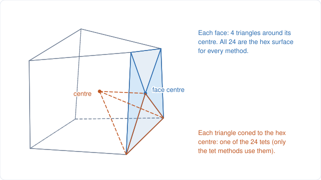
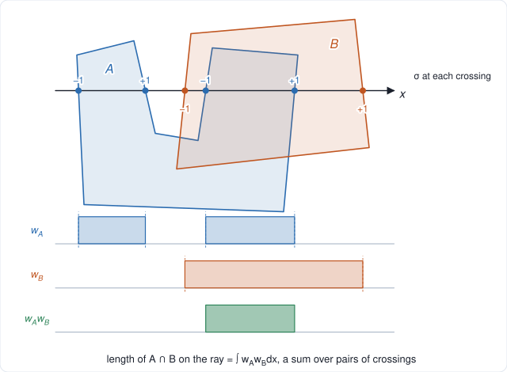

# Overlap moments straight from the boundary triangles

A copy of tet_intersection's `docs/projection_moments.md`. Unless they are links, file names below are
tet_intersection's.

This note explains how [`projection.hpp`](../src/tet/projection.hpp) computes the volume and
first moments of the overlap of two solids,

$$
V = \int_{A \cap B} dV, \qquad \mathbf M = \int_{A \cap B} \mathbf x \ dV,
$$

from nothing but their boundary triangles. It is used for two hexes (24 boundary triangles each,
or 12) and for a hex against a box (a Cartesian cell).

- **The solids need not be convex.** Methods that clip one convex region by the half-spaces of
  another (or the closed forms built on them) have to split a non-convex hex into 24 tets and
  intersect the 576 pairs of tets one by one. The method here works on the two hex surfaces directly.
- **No tie-breaking.** Every term is a continuous function of the vertex positions, so coincident
  faces, edges and vertices are just limits of the generic case.
- **It is fast:** it replaced clipping the hexes' tets and a closed form over them, and was 13×
  faster than that closed form on the GPU for hex-hex overlaps, and 6× for hex-Cartesian ones.

**Contents**

1. [Setup and notation](#1-setup-and-notation)
2. [Along one ray](#2-along-one-ray)
3. [Integrating over the rays](#3-integrating-over-the-rays)
4. [One pair of triangles](#4-one-pair-of-triangles)
5. [A hex against a Cartesian cell](#5-a-hex-against-a-cartesian-cell)
6. [Robustness](#6-robustness)
7. [GPU implementation](#7-gpu-implementation)
8. [Validation and performance](#8-validation-and-performance)
9. [References](#9-references)

The figures are generated from real geometry by tet_intersection's `docs/projection/make_figures.py`
(`python3 make_figures.py`).

---

## 1. Setup and notation

Each solid is given by a closed, outward-oriented triangulated surface: $\partial A$ and
$\partial B$. For a hex, whose faces need not be planar, they are its 24 boundary triangles: each face split into 4 triangles around the face centre (the average of
its corners), as in [`hex.hpp`](../src/tet/hex.hpp).

The same 24 triangles, coned to the hex centre, are the hex's 24 tets (`Hex::tets`), which give its
volume, and which a method going through tets would intersect: the same solid.

What is integrated is the product of the two surfaces' *winding numbers* $w_A$ and $w_B$:

$$
V = \int w_A\, w_B \ dV, \qquad \mathbf M = \int \mathbf x\, w_A\, w_B \ dV .
$$

For a surface that bounds a solid, $w$ is 1 inside and 0 outside, and this is the overlap. For a
hex so distorted that some of its 24 tets come out inverted, $w$ is the sum of the tets'
indicators with those tets counted negatively, which is exactly what intersecting the tets would
give too.

For a triangle $T$:

- $\sigma_T = \mathrm{sign}(n_{T,x})$ is the sign of the $x$-component of its outward normal;
- $\pi(T)$ is its projection onto the $yz$-plane;
- $x_T(y, z)$ is the height of its plane, so that $(x_T(y, z), y, z)$ lies on it.

Rays are parallel to $x$. Nothing depends on that choice; it only fixes which faces count as
"parallel to the rays" (and contribute nothing).

## 2. Along one ray

Follow the ray through $(y, z)$ in the direction of increasing $x$. Each time it crosses a triangle
$T$ of $\partial A$, it either enters $A$ ($T$'s outward normal points back along the ray,
$\sigma_T = -1$) or leaves it ($\sigma_T = +1$). So $w_A$ is a step function that jumps by
$-\sigma_T$ at $x_T$:

$$
w_A(x) = -\sum_{T} \sigma_T\, H(x - x_T), \qquad \sum_T \sigma_T = 0,
$$

with $H$ the unit step, and the sums over the triangles the ray crosses. The sum of the $\sigma_T$
is zero because the surface is closed: far along the ray, $w_A$ is back to 0.

The length of the overlap along the ray is therefore a sum over pairs of crossings, one of each
surface. Integrating up to some far point $X$,

$$
\int_{-\infty}^{X} H(x - a)\, H(x - b)\, dx = X - \max(a, b),
$$

and the $X$ terms cancel because $\sum_T \sigma_T = \sum_S \sigma_S = 0$:

$$
\int w_A\, w_B \, dx = -\sum_{T, S} \sigma_T\, \sigma_S \max(x_T, x_S).
$$

One more step makes most pairs drop out. Write $\max(x_T, x_S) = x_S + (x_T - x_S)^+$. The $x_S$
part sums to zero over $T$ (again because $\sum_T \sigma_T = 0$), leaving only the pairs where $T$
is *above* $S$:

$$
\int w_A\, w_B \, dx = -\sum_{T, S} \sigma_T\, \sigma_S \, (x_T - x_S)^+ .
$$

Check with $A = B =$ the unit cube: the ray crosses $x = 0$ ($\sigma = -1$) and $x = 1$
($\sigma = +1$) on each surface. The only pair with $x_T > x_S$ is $(x_T, x_S) = (1, 0)$, giving
$-(+1)(-1)(1 - 0) = 1$.

The first moments along the ray work the same way. With $\int_{\max(a,b)}^X x\, dx = X^2/2 - \max(a,b)^2/2$,

$$
\int x\, w_A\, w_B \, dx = -\sum_{T, S} \sigma_T\, \sigma_S \, \frac{x_T^2 - x_S^2}{2}\ [x_T > x_S],
$$

and the $y$ and $z$ moments are just $y$ and $z$ times the length.

## 3. Integrating over the rays

The ray through $(y, z)$ crosses $T$ exactly when $(y, z) \in \pi(T)$. Integrating the last two
results over all rays gives the whole method:

$$
V = -\sum_{T \in \partial A} \sum_{S \in \partial B} \sigma_T\, \sigma_S
\iint_{\pi(T) \cap \pi(S)} (x_T - x_S)^+ \, dy\, dz ,
$$

$$
M_x = -\sum_{T, S} \sigma_T\, \sigma_S \iint_{\pi(T) \cap \pi(S),\ x_T > x_S} \frac{x_T^2 - x_S^2}{2} \, dy\, dz ,
$$

$$
M_y = -\sum_{T, S} \sigma_T\, \sigma_S \iint_{\pi(T) \cap \pi(S)} y\, (x_T - x_S)^+ \, dy\, dz ,
$$

and $M_z$ the same with $z$ for $y$.

Each term involves one triangle of each surface and nothing else:

- a pair whose projections do not overlap, or where $T$ is nowhere above $S$, contributes nothing,
  which a box test detects;
- a triangle parallel to $x$ has no projected area and contributes nothing.

For two hexes that is 576 pairs (144 with 12 triangles each), most of which the box tests discard.

## 4. One pair of triangles

[`add_projected_pair`](../src/tet/projection.hpp) computes one term:

1. **Skip** if $T$ or $S$ is (nearly) parallel to $x$ (section 6.2), or if $T$'s highest point is
   not above $S$'s lowest.
2. **Clip** $\pi(T)$ to the edges of $\pi(S)$ (Sutherland–Hodgman). The vertices carry only
   $(y, z)$: $x_T$ and $x_S$ are linear in $(y, z)$, and are evaluated from the planes of $T$ and $S$
   where needed.
3. **Cut** the result where $\delta = x_T - x_S \ge 0$.
4. **Integrate** over the remaining polygon by fanning it into triangles. Over a triangle of area
   $A$ with vertex values $f_i$ and $g_i$ of linear functions,

   $$
   \iint f = \frac{A}{3} \sum_i f_i, \qquad \iint f g = \frac{A}{12} \left( \sum_i f_i g_i + \sum_i f_i \sum_i g_i \right),
   $$

   which gives $\iint \delta$, $\iint (x_T^2 - x_S^2)/2$, $\iint y\,\delta$ and $\iint z\,\delta$ exactly.
5. **Sign.** The polygon keeps $T$'s orientation, so its signed area already includes $\sigma_T$;
   the term is multiplied by $-\sigma_S$.

All coordinates are taken relative to the first solid's centre, so the terms (which cancel each
other in large part) stay small.

## 5. A hex against a Cartesian cell

A box $[\mathbf{lo}, \mathbf{hi}]$ has only two faces that are not parallel to $x$: $x = lo$
($\sigma = -1$) and $x = hi$ ($\sigma = +1$). Both project onto the cell's $yz$-rectangle $R$. So
each triangle $T$ of the hex has two terms, and they combine (with $h = hi - lo$):

$$
\sigma_T \iint_{\pi(T) \cap R} \Big[ (x_T - lo)^+ - (x_T - hi)^+ \Big] = \sigma_T \iint_{\pi(T) \cap R} \mathrm{clamp}(x_T - lo,\ 0,\ h) .
$$

The first moments become $(\mathrm{clamp}(x_T, lo, hi)^2 - lo^2)/2$ and
$y\, \mathrm{clamp}(x_T - lo, 0, h)$, $z\, \mathrm{clamp}(x_T - lo, 0, h)$.

So [`add_projected_box`](../src/tet/projection.hpp) clips $\pi(T)$ to $R$ once, and cuts the
result twice. The clamp is $h$ wherever $x_T \ge lo$, plus $x_T - hi$ where also $x_T < hi$:

- below $x = lo$: nothing (and a triangle entirely below the cell is skipped);
- above $lo$: the constant $h$;
- above $lo$ and below $hi$: the integrand $x_T - hi$ in addition.

The second part is cut from the first, so the part above $hi$ is never built.

A (hex, cell) pair costs 24 of these. The candidate cells of a hex come straight from its bounding
box; no BVH is needed.

## 6. Robustness

Every term of section 3 is continuous in the vertex positions:

- $(x_T - x_S)^+$ is zero on the cut, so it does not matter on which side a point of the cut lands;
- $\sigma_T$ only changes sign when $T$ is parallel to $x$, where its projected area is zero;
- the overlap $\pi(T) \cap \pi(S)$ changes continuously.

So the configurations that need tie-breaking in methods built on plane intersections (coincident
faces, three planes through one line, shared vertices) are simply limits of generic ones, and the formula gives their
limit. In floating point, each decision (which side of a line a vertex is on) only moves a boundary
by a rounding error, and the error in the result stays at the rounding level. In the tests, meshes
overlaid on themselves and meshes sharing their outer faces come out exact to about $10^{-17}$.

Two places still need care. The tests found both.

### 6.1 A cut whose integrand does not vanish

A first version split the part above $lo$ at $x = hi$ into the integrand $x_T - lo$ below and the
constant $h$ above. Those two are *equal* on the cut, not zero, so the cut was not harmless: a hex
face lying exactly in the plane $x = hi$ (common when hex and grid planes line up) lies entirely on
it, and with both sides keeping points on the cut, a unit-cube hex against the unit cell came out
with volume 2. Section 5's split avoids the problem: the only integrand that stops at $x = hi$ is
$x_T - hi$, which is zero there.

### 6.2 Triangles nearly parallel to the rays

A triangle's plane is evaluated as
$x = p_{0,x} - (n_y\, \Delta y + n_z\, \Delta z) / n_x$, so rounding errors grow like $1/n_x$.
The volume is unaffected, because the projected area shrinks like $n_x$ too, but $x^2$ in the
$x$-moment is not: its error grows like $\varepsilon^2 / n_x$. On the GPU, fused multiply-adds made
an exactly-zero $n_x$ (a triangle in a $y$ or $z$ plane) come out around $10^{-20}$, which gave
$x$-moment errors of $10^{-13}$. Skipping $T$ or $S$ when $|n_x| \le 10^{-12} |\mathbf n|$ ignores
at most $10^{-12}$ of its area and removes the problem (GPU and CPU now agree to $10^{-17}$). A face
in a plane $x = c$ has $n_y = n_z = 0$, so its plane gives exactly $c$, and $x_T - hi$ is exactly
zero on a face in the plane $x = hi$ (6.1).

## 7. GPU implementation

The kernels are in `intersect_hex_hex.cu` and
`intersect_hex_rect.cu`, with what they share in
`gpu_common.cuh`. [`algorithm_flow.md`](algorithm_flow.md) follows them,
and the queries around them, step by step, with figures.

**Hex pairs:** a warp per pair (`hex_projection_moments`), one warp per block.

1. Lanes 0–15 load one vertex each of the two hexes into shared memory. Lanes 0–23 then write
   triangle `lane` of each hex to shared memory, and the boxes of the first hex's triangles.
2. Lane $S < 24$ keeps the box of the second hex's triangle $S$ in registers and tests it against
   each of the first hex's 24 boxes in turn. `__ballot_sync` queues the $(T, S)$ pairs that pass.
3. The lanes share out the queue, so every lane does a full pair, and sum the terms with shuffles.

**Hex-cell pairs:** a warp per hex (`cell_projection_moments`), over its candidate cells 16 at a
time. The lanes queue every (cell, triangle) item that passes the box test, and share out the
queue. The terms of each round are summed per cell with a segmented scan over the lanes (the items
are in order of cell) instead of atomics, so the results are identical from run to run.

**The clipping buffers.** Each lane needs a polygon of up to 9 vertices. In local memory, the warps'
buffers far exceed L1, and the kernels spent most of their time waiting on L2. They live in shared
memory instead, padded to an odd number of doubles per lane so that the lanes' accesses do not
conflict. Shared memory then limits the warps per SM, so the vertices carry only $(y, z)$ (section
4), each block is one warp, and the polygon is clipped in place rather than back and forth between
two buffers. Clipping in place works because vertex $i + 1$ is read before the writes for edge $i$,
and those stay below it as long as at most 2 edges cross the line, as for a convex polygon. Rounding
can make a polygon that is nearly flat along the line cross it more often (coincident faces do);
then the vertices not yet read move up a slot or two to make room.

**Subzone pairs** (`HexSplit::diagonal`, 12 triangles per hex: the hexes of RAJAPerf's INTSC_HEXHEX,
section 8) have too few items to fill a warp: 8 per pair when the faces are aligned, 49 when
jittered. `hex_projection_moments_multi` handles 4 pairs per warp, queueing the items of all
together and summing them per pair with the same segmented scan as the hex-cell kernel.

Moment kernel times on an A100 after each step, for the benchmarks of section 8:

| step | hex pairs | hex-cell pairs |
| --- | ---: | ---: |
| one thread per pair | 17.8 ms | 24.2 ms |
| a warp per pair (hex) or per hex (cells) | 11.7 ms | 14.8 ms |
| queueing the pairs that pass the box test | 7.5 ms | (included above) |
| clipping buffers in shared memory | 3.4 ms | 6.0 ms |
| $S$'s plane slopes once per pair; hexes in shared memory, boxes in registers | 3.0 ms | 6.0 ms |
| vertices carry only $(y, z)$ | 2.6 ms | 5.0 ms |
| clipping in place (at 1200 MHz: from 2.87 and 4.63 ms) | 2.38 ms | 3.94 ms |
| plane slopes once per triangle (hex pairs), a reciprocal at crossings, overrun check only on crossings that write 2 vertices | 2.14 ms | 3.60 ms |

Clipping in place halved the buffers and took the registers from 108 to 96 per lane, for 17 warps
per SM instead of 11. For subzone pairs (`raja_comparison --hexhex`, at 1200 MHz), clipping in place
and 2 pairs per warp take the kernel from 1.48 to 0.76 ms unjittered and from 2.49 to 2.04 ms at a
jitter of 0.3, and the last row's steps to 0.64 and 1.76 ms, against 2.8 ms for RAJAPerf's own
kernel. The plane slopes are found once per triangle in the setup, rather than for both triangles of
every item (so 24 times per pair rather than about 100 when jittered), the hexes' volumes summed
there with shuffles, and `plane_x` takes a reciprocal and `parallel_to_x` compares squares (no square
root). The last row also took INTSC_HEXRECT from 2.80 to 2.35 ms.

When a warp's queue of subzone items is longer than a round, a second pass over it drops the items
that certainly add nothing (`separated_yz`): those whose projections are separated by an edge of
either triangle, 34% of the queue at a jitter of 0.3. The test is made in floats, with a margin that
covers their rounding, and without branches, so that the lanes stay together. It runs over full
rounds and saves rounds of clipping: 1.41 -> 1.30 ms at a jitter of 0.3, and no change unjittered
(one round, so no test).

At a jitter of 0.3, clipping is now 58% of the subzone kernel's time, with about 18 of 32 lanes of a
warp active (polygons of different sizes make the lanes loop different numbers of times), and the
FP64 pipe 70% busy. [`algorithm_flow.md`](algorithm_flow.md) follows the kernels step by step.

## 8. Validation and performance

`tests/hex_tests.cpp` checks partitions that must add up exactly:

- **Hex vs Cartesian:** a jittered hex mesh and a Cartesian grid filling the same box, and an
  unjittered hex mesh whose faces all lie on grid planes. The overlaps of each hex sum to its moments
  (from its tets), and those of each cell to the cell's.
- **Hex vs hex:** two jittered meshes of the same box (their outer faces coincide), and a mesh
  against itself, with either split of the faces. The overlaps of each hex sum to its moments, on
  both sides.
- **GPU:** the same overlaps as the CPU, to $10^{-14}$, including for a rotated, shifted mesh that
  only partly overlaps.
- **The GPU's filter** (`separated_yz`) drops only pairs of triangles that add nothing.

`apps/raja_comparison.cpp` checks against exact overlaps (unjittered),
and against RAJAPerf's own kernels, an implementation of their own (jittered).

**Performance**, from `mesh_compare` (A100 at 1200 MHz; CPU: i9-13900KF, 32 threads; best of 5 and
3 runs). Times in ms; GPU times include finding the pairs and dropping the empty ones.

| | CPU | GPU |
| --- | ---: | ---: |
| hex vs hex (`mesh_compare --hex 20 17`: 8,000 against 4,913 jittered hexes, 44,469 overlaps) | 37 | 2.5 |
| hex vs Cartesian (`mesh_compare --cart 40 60`: 64,000 jittered hexes against $60^3$ cells, 837,070 overlaps) | 56 | 3.2 |

---

## 9. References

1. B. Mirtich, "Fast and accurate computation of polyhedral mass properties", *Journal of Graphics
   Tools* 1 (1996), 31–50. The moments of one polyhedron by the same reduction: the divergence
   theorem, then projection onto a coordinate plane.
2. [`projection_optimization_log.md`](projection_optimization_log.md): every optimization tried on
   the GPU kernels, with its measurements.
